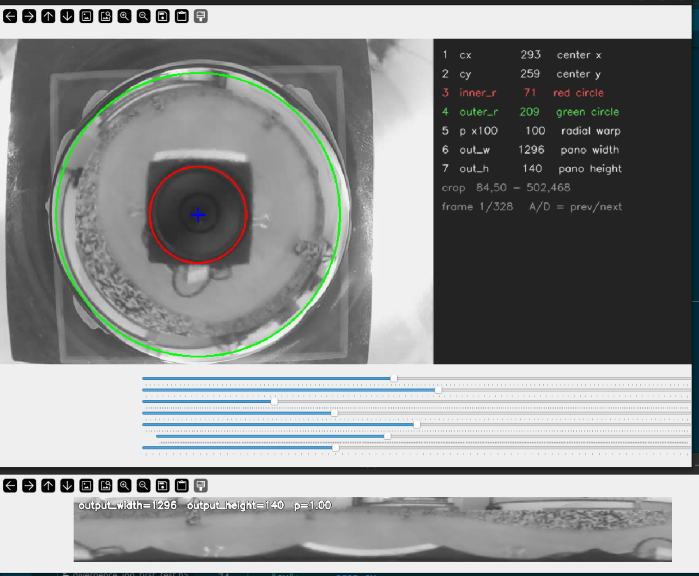
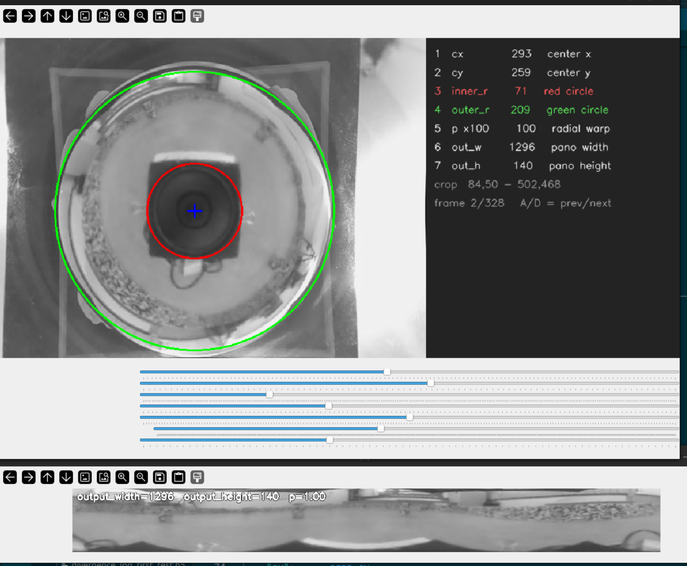

Due to the fact that the mirror doesn't fit the frame of the Pi camera perfectly, it needs to be cropped. This is what `calibrate_unwarp.py` is for: you set the circle center, the radii and the output size by eye, and it saves them. `calibrate_unwarp.py` stays on your computer and the files in `pi_code/` go on the Pi.

Requirements: `opencv-python` and `numpy` on both machines. On the Pi you also need `RPi.GPIO` and `Adafruit_PCA9685` for the robot.

## How to use

1. Record a video using `robot_toy.py`. Run it on the Pi over SSH. Drive with W/A/S/D, spin with Q/E, stop with X, and press **R** to start and stop recording (ESC quits). You don't need to move the robot, just a 1 sec video is enough. I provide the whole code so you can check if the construction is stable when the robot moves. The video is saved as an `.avi` in a `recordings/` folder. Move it to your computer, for example with `scp <user>@<pi-ip>:<path>/recordings/<video>.avi .`
2. To use `calibrate_unwarp.py`, you can directly in your terminal do `python calibrate_unwarp.py <video name>`.

2 windows will pop up. One is the settings where you can set the unwarp parameters, the second is how the unwarp will look.

The bars are labeled in the black box on the right, in the same order as the sliders. You can play around with it to see how the distortion changes.

Keys: **S** saves the values to `unwarp_cfg.json`, **H** tries to find the circle automatically, **A / D** go to the previous / next frame, **Q** quits without saving.

3. Copy the saved `unwarp_cfg.json` to the Pi, into the same folder as `start_cam.py`. Without it the Pi uses default values and the unwarp will look wrong.
4. Run `main.py` on the Pi. It streams the unwarped panorama at `http://<pi-ip>:8080/stream` (and the cropped image at port 8081). It also contains a small ArUco marker detection that I added to test if the camera can be detected, but it is not important for any of these things. That part needs an OpenCV version older than 4.7, or you can delete the ArUco lines.

## Parameters

### Outer radius (green circle)

It's important that the green circle is inside the frame. If it's outside, the circle will get clipped to the edge and will move the center.

### Inner radius (red circle)

I never found out what would be better for the red circle: to be smaller or bigger. The top of the sphere is always unusable, so there should be a small red circle. But due to the robot being big, a bigger red circle will exclude the robot body during the unwarp. If you decide to go this way (bigger red circle), you should adjust the output height of the panorama accordingly.

### Output width and height

If the difference of the radii of the two circles is smaller than the output height, the computer will make the pixels larger and there will be additional distortion in the panorama. The output width is good to be divisible by 360, but it is not required. A better reference is the number of pixels around the outer circle, which is about 2π × the outer radius. A larger width only interpolates and adds no real detail.

### Center

Don't always look for the center of the lens. Sometimes the physical center of the camera is not perfectly matching the optical center of the lens due to building the camera. Just eye the distortion: move the center until the left and right sides of the panorama look even.

### p value

p controls how the rows of the panorama are spread between the inner and the outer circle. With p = 1 the rows are evenly spaced along the radius. With p > 1 more rows go to the inner part of the circle (near the red circle) and the outer part is squeezed into a few rows. With p < 1 it is the other way around and the outer ring gets more rows. Because the mirror is curved, equal steps along the radius do not show equal steps in the real scene, so you can use p to compensate for this by eye.

## Barrel distortion

An important note to add is that the camera has inherent barrel distortion. I added my calibration file (`calib_result.npz`), but it is not used by default. To use it, create the camera with `UnwarpCamera(calib_path="calib_result.npz")` in `main.py`. The file only fits my camera at my focus setting. If you plan to use multiple robots, you will need to set the focus distance of the lens manually (because the camera has a manual setting). When you do that, maybe you will need to redo the distortion calibration. Because the mirror is so close to the camera, I used my phone screen as the board and held it close to the camera, at the same distance as the mirror will be.

<table>
  <tr>
    <td align="center"> <b>Barrel distortion</b></td>
    <td align="center"> <b>No barrel distortion</b></td>
  </tr>
</table>
